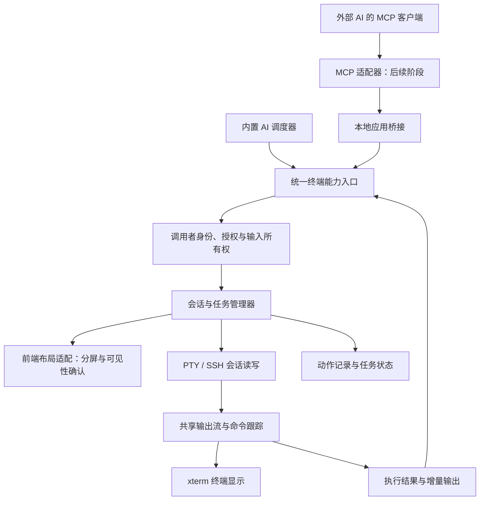

# AI 终端执行、分屏协作与 MCP 接入规划

日期：2026-10-13。状态：设计草案，待实施。

本文定义后续开发的目标、接口边界和验收条件。本次仅编写规划文档；可见执行、AI 自动分屏、任务执行器和 MCP 服务均未实现，也未启用任何外部访问。

## 1. 目标与范围

wterm 为 AI 提供可见、可控制的终端操作能力。用户可以看到 AI 在真实终端中执行的命令、实时输出和分屏操作，并随时暂停或接管。

三个目标按阶段推进：

1. 内置 AI 在用户指定的终端执行命令，读取结果并继续排查。
2. 内置 AI 创建左右或上下分屏，在多个独立终端中安排并行或有依赖的任务。
3. 后续通过 MCP 将同一套能力提供给外部 AI，沿用 wterm 的展示、授权、任务管理和操作记录。

本轮交付为本文。后续阶段须另行安排实施；本文中的接口、状态、模块和默认参数均为设计建议，不能作为当前已提供的 API 使用。

首轮实现建议限定为本地 PowerShell、单个可见窗格、单行命令和可靠的命令结束采集。SSH、多窗格以及外部 MCP 分阶段验收。全屏交互程序、密码自动填写、任意按键自动化、后台无界面执行、远程公网控制、自动部署与自动回滚不纳入首轮范围。

## 2. 已有基础与缺口

以下结论来自当前工作区源码核对，源码功能与正式安装包的发布状态应分别核验。

| 能力 | 当前基础 | 后续需要补齐 |
| --- | --- | --- |
| AI 对话 | `src/ai-panel.ts` 管理对话、请求、历史和命令插入；`src-tauri/src/ai.rs` 调用模型服务 | 工具参数组装、校验、执行及工具结果回传，形成多步循环 |
| 终端写入 | `src/terminal.ts` 经 IPC 向指定会话写入；`src-tauri/src/webview.rs` 和 `session.rs` 统一处理本地 PTY 与 SSH | 面向任务的执行入口、独占输入、授权检查和结果状态 |
| 命令采集 | `src/blocks.ts`、`src/terminal.ts` 处理 OSC 133 命令边界和退出码；本地 PowerShell 有提示符集成 | 独立于命令历史面板的执行跟踪、输出游标、丢失和不确定状态 |
| 分屏 | `src/layout.ts` 描述分屏树；`src/main.ts` 的 `toggleSplitScreen` 创建窗格及会话 | 按明确的源会话操作，返回新会话 ID，提供布局完成确认 |
| SSH 多通道 | `newSshSessionOnExisting` 和后端 `spawn_ssh_on_existing` 可复用 SSH 连接建立独立 Shell 通道 | 会话元数据、目标检查、远端命令边界和通道数限制验收 |
| 取消请求 | 已有按窗口和请求 ID 区分的模型请求取消 | 分离模型取消、任务暂停、前台命令中断和会话关闭 |
| 对话持久化 | 本地 SQLite 保存 AI 对话；连接有稳定身份 | 任务和执行记录，以及应用重启后的状态处理 |
| MCP 接入 | 尚无终端控制 MCP 服务 | 客户端配对、传输适配、应用桥接、权限及兼容性验证 |

当前“插入终端”只接受受限单行文本，不追加回车，也不向其他终端广播。后续应保留这个操作，同时新增语义明确的“执行”。当前模型请求工具调用时会明确报错；识别工具名称不等于具备执行器。

当前布局和部分会话信息由前端管理，Rust `AppState.sessions` 保存底层 PTY/SSH。仅开放现有写入 IPC 无法形成完整的外部控制能力，还需要统一会话元数据、输入状态和布局桥接。

## 3. 用户使用场景

### 3.1 在当前终端执行并显示全过程

用户：“检查这个项目为什么启动失败。”

预期流程：

1. AI 说明准备在哪个终端执行什么动作。动作卡显示连接目标、目录、命令和用途。
2. 用户点击执行，或使用此前为本次任务授予的有效权限。
3. wterm 检查目标会话、输入状态和权限，提交命令。命令与输出显示在原终端中。
4. AI 收到本次命令的输出、结束状态和退出码，再决定下一步。
5. 任务结束时给出结论及对应执行记录；用户可以继续手动使用这个终端。

使用同一个 Shell 时，`cd` 和环境变量等状态可延续。首次接管已有终端必须确认提示符空闲且没有用户未提交的输入；状态不可靠时暂停，或建议创建专用窗格，不自动清空用户输入。

终端一般会回显命令，但某些程序关闭回显。动作记录必须独立显示实际提交的命令；不能为制造可见效果而伪造终端输出或把命令打印内容当成已执行证据。

### 3.2 自动分屏并协作执行

用户：“启动服务，同时观察日志，确认接口可以访问。”

| 窗格 A：运行服务 | 窗格 B：检查状态 |
| --- | --- |
| 设置明确的项目目录 | 设置明确的日志目录或项目目录 |
| 启动服务，持续显示输出 | 跟踪日志或检查端口 |
| 保持服务进程运行 | 服务达到就绪条件后发起接口请求 |

AI 可以提出左右或上下分屏，wterm 完成布局和新会话创建，返回会话 ID 后再执行。一个 AI 可以调度多个终端，无须为每个窗格创建一个模型实例。

不同窗格是独立 Shell，不共享当前目录、变量或前台进程。新窗格复用本地 Shell 类型或已授权 SSH 目标；目录需显式设置并核验，环境变量只按明确策略传入。不得假定复制了原终端的全部状态。

多窗格任务由任务 ID 关联。用户切换焦点不会改变任务目标；用户关闭窗格、断开连接或移动会话时，管理器应检测变化并暂停相关步骤。首版建议运行中的任务禁止跨应用窗口迁移，待后续支持可验证的所有权转移。

### 3.3 外部 AI 调用同样的能力

用户在外部 AI 中提出排查请求，外部客户端通过 MCP 请求 wterm 查看授权会话、创建分屏、执行命令和读取结果。

所有动作仍在 wterm 展示。操作来源标记为已配对的客户端，用户可以在 wterm 中撤销授权、接管窗格或停止任务。外部 AI 的会话上下文由外部客户端维护；wterm 保存本地操作记录，不要求内置 AI 面板开启或配置模型 Key。

首个 MCP 版本仅面向同一台电脑上的客户端，要求 wterm 已运行且目标应用窗口可用。桌面应用未运行时返回明确错误；不静默启动另一套无界面 Shell。

## 4. 架构与职责



架构决策建议：

- 终端能力入口与模型服务分离。内置 AI 和 MCP 均调用同一业务契约，不各自实现执行和权限规则。
- Rust 侧管理输入所有权、授权、会话代次、执行状态和有界输出缓存；前端负责布局、可见性、接管入口和动作展示。
- 后端创建布局请求，前端返回匹配请求 ID 的确认。新会话必须注册到布局、完成终端 IO 绑定并确认可见后，才允许提交 AI 命令。失败时清理本次创建的空会话，保留原窗格。
- 当前由前端处理的命令边界需整理为可复用的跟踪能力，并使后端具有可信的会话输入状态。不能仅凭一次旧的前端“空闲”上报就授权写入。
- AI 写入与人工输入进入一致的状态跟踪路径，保证目录、命令历史和结束采集一致。AI 指定目标执行始终绕过广播，不能因用户开启广播而扩大执行范围。
- 工具执行依据经过完整组装、参数校验的结构化请求。模型流式返回尚未完整的参数时，不执行；不扫描普通回复中的代码块并自动运行。
- 工具结果按调用 ID 回传模型。工具失败、参数异常和执行不确定必须进入明确状态，不能伪造成功或靠模型文字判定执行事实。

模块拆分可考虑后续新增 `terminal-agent` 前端适配模块，以及 Rust 的 `terminal_control`、`task_manager`、`execution_tracker`、`agent_policy`；MCP 和本地桥接在后续独立模块中实现。名称待实施时确定，本轮不创建代码或依赖。

## 5. 会话、任务与执行模型

### 5.1 身份与绑定

| 对象 | 建议字段 | 用途 |
| --- | --- | --- |
| 调用者 | `principal_id`、来源类型、已配对客户端名 | 区分内置 AI、外部客户端和人工操作；由入口认证后生成 |
| 会话 | `app_instance_id`、`window_id`、`session_id`、`generation` | 固定目标；应用重启和连接重建后使旧引用失效 |
| 目标 | 本地/SSH、连接身份、实际主机/端口/用户、Shell、目录及可靠性 | 显示目标、核验授权，避免配置改名或改地址后误用 |
| 任务 | `task_id`、目标描述、允许会话、授权、步数与时间预算 | 关联一次用户目标，可管理多个窗格 |
| 执行 | `execution_id`、会话引用、实际命令、状态、时间、输出游标、退出码 | 区分多次执行，关联准确输出 |
| 输入所有权 | 当前所有者、租约期限、接管状态 | 单个会话同时只有一个自动执行者 |

上述身份字段不能由模型自行声明后直接信任。每次读写都验证调用者对任务和会话的访问权限；知道会话 ID 不代表拥有访问权限。

SSH 自动重连会改变 `generation`。原任务变为目标失效，重新核验后由用户恢复，不自动在新连接上重放旧命令。SSH 复用新通道也有独立 `session_id`。

### 5.2 状态与事实

任务状态建议：`proposed → awaiting_approval → running → completed / failed`。运行中可进入 `paused` 或 `cancelled`；连接、跟踪或输入状态不确定时进入 `needs_attention`。

执行状态建议：`pending → submitted → running → completed`，并支持 `rejected`、`failed`、`unknown`。`submitted` 只表示写入或通道提交已接受；`completed` 表示命令边界结束，是否成功再根据退出码判断。命令非零退出不等于整个排查任务失败，后续判断仍受任务授权范围限制。

| 情况 | 正确反馈 |
| --- | --- |
| 写入被接受，但尚未观察到命令开始 | `submitted`，继续跟踪，不返回“执行成功” |
| 命令结束且退出码为 0 | `completed`，`exit_code=0` |
| 命令结束且退出码非零 | `completed`，返回真实非零退出码和输出 |
| 结束边界可识别但没有可靠退出码 | `completed`，`exit_code=null`，不判断成功 |
| 查询等待超时 | 返回当前状态及 `wait_timed_out=true`；命令可能仍在运行 |
| 连接断开、提交结果丢失或跟踪失效 | `unknown`，保留已有输出，停止依赖步骤 |
| 中断请求已发送 | 单独标记 `interrupt_requested`，等待实际结束，不能直接宣称已终止 |

对外 JSON 使用固定状态枚举，具体错误放在 `error_code` 和说明字段中，不根据错误提示文字推断状态。

### 5.3 并发与任务依赖

- 不同会话可以并行；同一会话只允许一条未结束的前台执行。忙碌时返回 `SESSION_BUSY`，不把命令自动排进未知程序的输入。
- 多任务抢同一个会话时由管理器仲裁；内置 AI 与外部 AI 同样受此限制。
- 长时间运行的服务、`tail -f` 等以持续执行模式跟踪。任务必须声明是否保留进程，不能把“持续运行”当作失败。
- 就绪判断支持有界的输出匹配或另一窗格中的显式检查，并设置超时。就绪和进程退出是两个不同条件；输出匹配仅为业务信号，不是授权证据。
- 初始建议限制为最多 2 个 AI 窗格、20 个动作和 10 分钟调度时间，作为待验证的默认值。预算耗尽停止新增动作并请求用户处理，保留已启动进程。
- 创建窗格和写入命令均需要幂等请求 ID。相同调用者重试同一请求返回原结果；同一 ID 参数变化拒绝。请求已提交但结果未知时不自动再次写入。
- 去重记录在授权有效期内保留；应用重启后的旧任务不再有效。不能把短期缓存去重描述为跨故障的“绝对只执行一次”。

## 6. 能力接口草案

以下为统一业务接口候选；MCP 后续只做协议映射，不将现有内部 IPC 直接全部开放。

| 工具候选名 | 主要参数 | 结果与约束 |
| --- | --- | --- |
| `terminal_list_sessions` | 授权范围内的窗口筛选 | 返回授权且可见的会话、代次、目标、输入状态和采集能力；不枚举未授权连接配置 |
| `terminal_get_session` | 会话引用 | 返回当前目标、目录、所有者、忙碌状态和支持的能力 |
| `terminal_create_split` | 任务 ID、源会话、左右/上下、用途、可选目录、幂等 ID | 返回新会话引用；等待布局及 IO 就绪，核验目标 |
| `terminal_execute` | 任务 ID、会话引用、命令、用途、有限/持续模式、幂等 ID | 校验后返回执行 ID 及提交状态；不阻塞直到长任务结束 |
| `terminal_read_output` | 执行 ID、游标、最大字符数 | 返回该执行的增量文字、下一游标、截断/丢失标记和当前状态 |
| `terminal_wait_execution` | 执行 ID、最多 30 秒等待 | 有界等待结束或状态变化；等待超时不自动中断命令 |
| `terminal_interrupt` | 执行 ID、原因 | 在权限允许时请求中断，并返回是否已观察到结束 |
| `terminal_get_task` | 任务 ID | 返回窗格、执行、依赖、预算和当前授权状态 |
| `terminal_pause_task` | 任务 ID、原因 | 停止新增动作；已经运行的命令继续跟踪 |

任务创建及授权入口由 wterm 用户界面掌握。未来可增加 `terminal_request_task`，允许外部客户端提交目标和所需权限，返回待授权任务 ID；该调用本身不能授予权限。

首版不开放任意原始字节输入、按键注入、读取凭据、自动响应密码、任意连接新主机或自动关闭用户原有会话。AI 创建的空窗格清理由内部管理器处理；有进程的窗格关闭需单独处理，不能当成普通分屏整理。

业务结果示例（不代表可直接发送的 MCP 报文）：

```json
{
  "task_id": "task-example",
  "execution_id": "exec-example",
  "session": {
    "app_instance_id": "app-example",
    "window_id": "window-example",
    "session_id": "session-example",
    "generation": 1
  },
  "state": "running",
  "exit_code": null,
  "output": "服务正在启动……",
  "next_cursor": "opaque-cursor",
  "truncated": false,
  "output_gap": false,
  "error_code": null
}
```

接口能力版本与 MCP 协议版本分别管理。客户端先发现会话支持的能力；不支持可靠退出码、分屏或持续执行时，明确返回限制，不猜测能力。

## 7. 命令边界与输出采集

终端输出流同时用于 xterm 展示和执行跟踪，不从屏幕截图或可见最后几行推断完整结果。PTY 会混合标准输出、标准错误和终端控制序列，对外返回终端输出，不伪称已经分离 `stdout` / `stderr`。

优先沿用并完善 Shell 集成：OSC 133 标记提示符、命令开始和结束，退出码来自支持该能力的 Shell。本地 PowerShell 为首个验收目标；cmd 与远端 Shell 的能力需逐项核验。普通文本提示符和“数秒没有输出”不能作为可靠完成依据。

自动执行器应记录自己提交的命令与执行 ID，并关联经过输入所有权管理的边界。OSC 标记也可能被程序输出伪造，不能作为权限或安全隔离机制；出现矛盾的边界、用户输入或备用屏幕切换时暂停自动调度。

实施时评估将集成安装和跟踪结果绑定到具体会话代次，以及跨输出分片、光标控制、粘贴、补全和编码的处理。不能仅复用当前失败诊断的有限文字就声称具备完整执行跟踪。

缓存初始建议为每个执行保留最近 256 KiB 文字数据、每次读取最多 16,000 字符，并设置全局预算。这些数值待性能验收调整。游标对截断、缓存淘汰、过期执行明确返回 `output_gap`，不能悄悄把缺失输出当成完整结果。终端回滚缓存与 AI 结果缓存分别管理，AI 截断不清除用户终端历史。

首版模型默认只能读取任务启动后、授权执行产生的有限输出。读取既有终端历史需要用户显式附带或独立授权。返回模型或外部客户端前处理 ANSI 控制、有限脱敏与长度预算；本地终端继续显示正常原始流。脱敏无法保证覆盖全部机密，用户应能预览本次共享范围。

## 8. 授权、接管与界面行为

### 8.1 授权边界

执行能力默认关闭；启用后建议提供两种方式：单次命令批准、限定任务授权。后者在用户明确批准的会话、工具、期限和动作范围内继续执行，范围内不重复打断用户。自动诊断开关不授予执行权限。

授权由 wterm 保存，并绑定调用者、任务、实际目标、允许工具、输入所有权和期限。命令分类只能辅助展示，不能仅靠关键词过滤或模型自评把任意 Shell 命令认定为安全只读。首版默认单次批准；自动执行只适用于明确限制的操作模板或已审阅的命令集合。任意命令的任务授权应明确告知其权限范围。

新主机、提权、删除、部署或超出原范围的动作需要新增授权。目录限制对任意 Shell 命令只是上下文限制；若需要强制文件或网络隔离，应另行使用操作系统级隔离，不能宣称指定 `cwd` 就形成沙箱。

终端输出、日志、文件和 MCP 工具结果中的文字均视为数据，不能据此扩大授权。应用校验会话和参数，防止输出中的指令驱动 AI 越权操作。

### 8.2 用户接管与停止

| 用户动作 | 预期行为 |
| --- | --- |
| 切换焦点或查看另一个标签 | 仅改变视图，任务继续绑定原会话 |
| 折叠 AI 面板 | 按当前聊天体验折叠，任务状态仍在窗格或工具栏可见 |
| 接管某个 AI 窗格 | 原子撤销自动输入权，暂停相关任务步骤；后续人工输入正常送达 |
| 暂停任务 | 不再下发新动作，保留运行中的命令和输出跟踪 |
| 中断命令 | 尝试 Ctrl+C 或相应通道操作，等待结束确认；不保证所有进程都会终止 |
| 停止模型回复 | 取消模型网络请求，不自动杀掉已启动命令 |
| 关闭 AI 面板 | 暂停内置执行任务并取消模型请求；外部任务仍由独立任务入口控制 |
| 撤销外部客户端授权 | 拒绝后续读写，暂停调度；已启动进程保留并提示用户处理 |
| 关闭应用 | 显示未结束任务与现有会话关闭的影响；启动恢复时不重放命令 |

AI 控制窗格期间提供明确接管按钮。首次键盘输入触发接管后再处理输入，避免静默丢弃用户按键；切换视图不等于接管。接管、授权撤销和命令提交必须在同一控制入口中串行核验，阻止已排队动作在撤销后继续执行。

界面显示操作来源、任务用途、目标和运行状态，提供单任务控制与“暂停所有 AI 任务”。动作记录包括提出、批准、提交、结束、错误和人工接管；只展示模型说明与可验证操作结果，不要求显示模型内部推理。

暂停、中断和关闭不能撤销已经发生的文件修改或远端操作。任务结束时说明哪些进程继续运行，不能把“调度完成”显示成“所有进程已退出”。

## 9. 未来 MCP 接入

### 9.1 同一套终端能力

接入方向是 wterm 提供 MCP Server，外部 AI 所在应用作为 MCP Client 调用。MCP 适配器完成工具发现、参数和结果映射；执行策略、权限判断和终端展示全部沿用统一能力入口。

MCP 提供带输入模式的工具发现和调用，并支持结构化结果。工具注解不能代替 wterm 的实际权限校验；工具集可按调用者授权范围提供。协议参考 [MCP Tools](https://modelcontextprotocol.io/specification/2026-07-28/server/tools)。

外部客户端只能发现和读取授权会话；任务、会话、执行 ID 在每次调用中显式携带，不依赖连接的“当前终端”。客户端可陈述用途，可信来源身份由配对和认证确定，不接受模型自填客户端名作为认证依据。

### 9.2 本地接入优先

首个 MCP 版本建议采用独立 stdio 适配进程，连接已运行的 wterm。标准 MCP 传输包含 stdio 与 Streamable HTTP；具体报文和兼容行为以实施时选定版本为准。参考 [MCP Transports](https://modelcontextprotocol.io/specification/2026-07-28/basic/transports)。

适配进程只转换协议，不自行创建后台终端。Windows 本地桥接可评估当前用户受限的命名管道；其他平台后续评估 Unix socket。应用实例选择、访问权限、客户端配对和随机凭据均由受控桥接实现。stdio 协议输出与诊断日志分离，诊断不得污染协议通道。

用户从 wterm 启用外部访问、选择客户端与允许会话。启动的适配进程通过受保护的本地配对机制取得身份，每次操作核验范围。API Key、SSH 密码、私钥和完整连接配置不通过工具返回；外部 AI 使用客户端自身的模型服务凭据。

只拥有本地进程身份或协议连接不足以取得全部终端权限。多个应用实例必须由用户指定目标实例，不能按“最近活动窗口”静默选择。应用无可用窗口、布局桥接失联、客户端未配对或授权过期时，返回明确错误。

MCP 调用取消或适配进程退出，默认停止等待及后续调度，并释放或暂停控制租约；已启动的命令继续跟踪，不把协议取消当成进程中断。客户端重连后先查询原执行状态，不重发不确定的命令。

### 9.3 HTTP 与远程接入后置

Streamable HTTP 作为后续候选，用于需要 HTTP 的客户端。必须单独设计鉴权、客户端兼容、访问限制、来源检查和凭据保护；本地监听也不能默认提供无认证控制接口。公网或局域网开放不属于首个 MCP 版本。

MCP 的 HTTP 授权有独立规范，stdio 的凭据处理方式与其不同。选择 HTTP 时按目标协议及客户端能力核验授权机制，不把本地配对方案直接当作对远程客户端的完整授权实现。参考 [MCP Authorization](https://modelcontextprotocol.io/specification/2026-07-28/basic/authorization)。

### 9.4 版本与兼容性

2026-10-13 查阅官方 `latest` 页面时指向 `2026-07-28` 规范。此处固定链接用于追溯设计依据，不代表已经决定产品支持该版本。实施 MCP 前选择至少一个实际目标客户端，核验其支持的协议、传输、授权及结构化结果，再确定版本与兼容策略。

基础长任务接口采用业务执行 ID 加有界查询，不要求客户端具备某个可选异步扩展。完整 MCP Schema、连接配置样例、打包路径和认证细节在 MCP 阶段提供；本轮不生成看似可用的接入配置。

## 10. 持久化与异常恢复

AI 对话与执行记录分开存储、通过任务 ID 关联。记录实际命令、调用者、目标快照、批准范围、时间、状态与有限结果摘要；凭据不写入记录。保存周期、清理和用户删除入口在实施阶段确定，不能无限保存终端输出。

应用重启后历史任务显示为已中断或状态未知，不恢复输入控制租约，不自动重建执行授权，也不重放命令。恢复终端历史与恢复真实进程分别处理。远端进程可能在断线后继续存在，必须重新查询确认。

| 异常 | 处理原则 |
| --- | --- |
| 模型请求失败 | 停止新增动作，保留已执行记录及当前进程 |
| 分屏或新会话创建失败 | 返回失败，清理本次空会话，不改变用户原会话 |
| 写入失败或接受状态不确定 | 区分明确未提交与未知；未知情况禁止自动重试 |
| 用户输入、交互提示或全屏程序 | 暂停调度，由用户处理，不自动输入密码或确认选项 |
| 输出超预算或游标丢失 | 返回截断/缺口；要求补充检查，不假定完整 |
| 窗格关闭、连接重建或布局确认失联 | 使原目标失效，停止依赖步骤 |
| 外部客户端掉线或授权撤销 | 拒绝新调用、暂停任务，显示仍运行的命令 |
| 到达任务预算 | 暂停新增动作，说明已执行内容和未完成项 |

## 11. 实施阶段与验收

### 阶段 A：单终端可见执行

范围：本地 PowerShell、单次批准、有限单行命令、执行结果回传 AI、接管和任务暂停；先建立统一接口与任务身份。

验收：

- 真实桌面 PTY 中能看到提交的命令和实时输出，模型拿到准确的退出码及限定输出。
- 空提示符之外、存在未提交输入、备用屏幕、输入状态不可靠或文件传输中时，执行被拒绝或暂停。
- 用户切换焦点、开启广播、旧回复晚到和重复请求均不会改变目标或重复提交。
- 接管与提交竞态、超时、模型取消、断流、非零退出和缺失边界有明确结果。
- 原有“插入终端”仍不追加回车，聊天与历史功能可正常使用。

### 阶段 B：连续排查与 SSH

范围：可靠的多步循环、限定任务授权、持续执行模式、支持 Shell 集成的 SSH 会话。

验收：可靠就绪条件驱动下一步；任务预算有效；失败和未知状态不会触发盲目重试；SSH 重连、通道限制和不支持退出码场景可见且可控。使用真实模型及独立测试 SSH 环境验证，不调用生产任务。

### 阶段 C：双窗格协作

范围：AI 发起左右/上下分屏、源会话目标固定、两窗格并行与依赖调度。

验收：新窗格可见且已就绪后才能执行；目录分别核验；输出和退出码准确归属；启动服务与检查接口可同时运行；人工接管一个窗格不会误中断另一个；部分创建失败、多个任务竞争会话和关闭窗格可恢复处理。

### 阶段 D：外部 MCP

范围：本地 stdio 适配器、受控应用桥接、客户端配对与会话授权，共用前面阶段的能力。

验收：至少一个实际外部客户端可发现授权工具、创建可见分屏并执行任务；外部操作来源显示；未授权读取和写入、过期授权、伪造会话、跨应用实例访问均被拒绝；wterm 无窗口时不创建隐藏 Shell；客户端断线、重连和取消不会重复执行。

HTTP 和远程接入另行规划验收，不作为阶段 D 的隐含范围。

测试分别覆盖契约/状态单元测试、模拟模型和桥接的界面测试、真实 PTY、独立 SSH、真实模型服务与真实 MCP 客户端。模拟界面或协议服务通过不能代替真实终端和模型工具调用验收。本次文档交付不产生任何功能测试通过的结论。

## 12. 后续实施前需要确定的选项

| 选项 | 当前建议 | 决定时点 |
| --- | --- | --- |
| 首轮平台与 Shell | Windows 本地 PowerShell | 阶段 A 开始前 |
| 授权默认方式 | 单次批准；任务授权逐步加入 | 阶段 A/B |
| 已有终端与专用窗格 | 两者可支持，已有终端需核验空闲；状态不可靠时使用专用窗格 | 阶段 A |
| 任务预算、输出缓存与记录保留 | 采用本文初始建议，通过真实运行调整 | 各阶段性能验收 |
| 持续进程的结束策略 | 用户决定保留或中断，不默认杀掉 | 阶段 B/C |
| 首个外部 MCP 客户端 | 根据用户实际使用的客户端确定 | 阶段 D 开始前 |
| MCP 版本、SDK 与桥接方案 | 先核验客户端，再选择实现依赖 | 阶段 D 开始前 |
| HTTP / 跨电脑控制 | 后置为独立项目范围 | 本地 MCP 验收后 |

无需为完成本文先决定全部选项。后续从阶段 A 推进，并保留统一能力入口和显式身份，为 MCP 接入提供兼容基础。

## 13. 关联材料

- [功能清单](feature-list.md)：当前实现核验与规划。
- [AI 历史会话](ai-history.md)：当前聊天、连接归属与本地保存行为。
- [AI 功能 review 与实现记录](ai-review.md)：现有 AI 实现及验证边界。
- 当前代码入口：`src/ai-panel.ts`、`src/ai-helpers.ts`、`src/terminal.ts`、`src/blocks.ts`、`src/main.ts`、`src/layout.ts`、`src-tauri/src/ai.rs`、`src-tauri/src/webview.rs`、`src-tauri/src/session.rs`、`src-tauri/src/state.rs`、`src-tauri/src/pty.rs`、`src-tauri/src/ssh.rs`。
